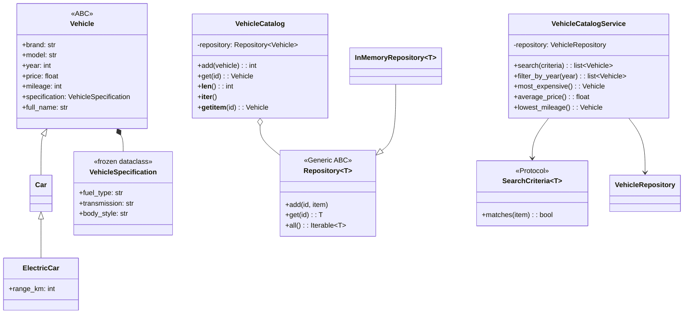

# Лабораторна робота №4

## Професійне ООП та система типів Python

**Виконав:** Горин Михайло  
**Дисципліна:** Професійний Python  
**Варіант:** 5 — каталог автомобілів  
**Навчальний заклад:** ЛНУ ім. Івана Франка  
**Спеціальність:** 121 — Інженерія програмного забезпечення

## Мета та предметна область

Мета роботи — побудувати типізовану об'єктну модель для каталогу транспортних засобів, відокремити доменну логіку від зберігання, описати контракти залежностей і перевірити типи статично. Проєкт розвиває каталог із ЛР1–ЛР3, зберігаючи чинну сутність `Car` та потоковий CSV pipeline.

Варіант 5 вимагає додавання авто, пошуку за маркою/моделлю, фільтрації за роком, пошуку найдорожчого авто, обчислення середньої ціни та мінімального пробігу, repository і abstraction для критеріїв пошуку.

## Domain model та архітектура

Основні сутності: `Vehicle` — базова абстракція автомобіля; `Car` — звичайний автомобіль; `ElectricCar` — електричний підтип із запасом ходу; `VehicleSpecification` — незмінний value object; `VehicleCatalog` — колекція автомобілів; `VehicleCatalogService` — application service.



`ElectricCar is a Car` — виправдане наслідування: електромобіль має всі властивості автомобіля та додає запас ходу. Каталог має repository (`has-a`), тому використовує композицію. Сервіс залежить від `VehicleRepository` Protocol, а не від конкретного in-memory класу: реалізацію можна замінити без зміни сценаріїв каталогу.

## ООП і система типів

- `Vehicle`, `Car`, `ElectricCar`, `VehicleSpecification`, `BrandModelCriteria`, `YearCriteria` — dataclass-моделі. `VehicleSpecification` і транспортні засоби frozen, щоб незмінний опис/запис не змінювався непомітно після створення.
- Encapsulation: сховище зберігає індекс у `_items`; `VehicleCatalog` надає `add/get/all`, а `Vehicle` перевіряє ціну, рік і пробіг під час створення.
- Property: `Vehicle.full_name` формує назву автомобіля з марки й моделі.
- Dunder methods: `Vehicle.__str__` дає читабельний опис; `VehicleCatalog.__len__`, `__iter__`, `__contains__`, `__getitem__` інтегрують каталог із вбудованими операціями Python.
- ABC: `Repository[T]` визначає абстрактні операції `add/get/all`; не можна створити неповну реалізацію репозиторію.
- Protocol: `SearchCriteria[T]` описує `matches`, а `VehicleRepository` — контракт сервісу. Criteria сумісні структурно, без наслідування від конкретного базового класу.
- `Repository[T]` і `InMemoryRepository[T]` використовують `TypeVar` та Generic; один клас може зберігати різні типи сутностей.
- `VehicleData` — TypedDict для JSON-подібного представлення. Він лишається словником на runtime; dataclass використовується для доменних об'єктів із поведінкою.
- `VehicleCatalogService.to_data()` формує DTO без змішування транспортного об'єкта з транспортним форматом.

## Application service та DI

`VehicleCatalogService` отримує `VehicleRepository` через конструктор. У `oop_demo.py` composition root створює `InMemoryRepository`, передає його сервісу та додає демонстраційні записи. Це забезпечує SRP (сховище і сценарії розділено), OCP (нові criteria/repository можна додавати без переписування сервісу) та DIP (сервіс залежить від Protocol). Заміна in-memory repository на файлову чи БД реалізацію і підміна fake repository для ізольованого тесту не вимагають змін business logic.

У `BrandModelCriteria` перевірка марки й моделі винесена в окрему стратегію. `YearCriteria` має ту саму структурну операцію `matches`, отже пошуковий сервіс розширюється без `if` за типом кожного критерію. Композиція repository у каталозі зменшує зв'язність порівняно з наслідуванням каталогу від конкретного сховища.

## Демонстраційний запуск

```bash
python -m car_catalog.oop_demo
```

Або з інтерактивного застосунку:

```bash
python -m car_catalog.main
```

Вибрати пункт 13. Демонстрація показує пошук за маркою, рік, найдорожче авто, середню ціну та найменший пробіг.

## Статична перевірка типів

Встановити залежність розробника та перевірити ООП-модулі:

```bash
python -m pip install -e ".[dev]"
python -m mypy
```

Конфігурація strict-mode і список модулів розташовані в `pyproject.toml`. Експеримент із навмисними помилками відтворюється окремим тимчасовим файлом; помилкові приклади не залишаються в робочому коді:

```python
customer_id: int = "1"  # incompatible assignment

def total() -> int:
    return "100"  # incompatible return value

repository: InMemoryRepository[Car] = InMemoryRepository()
repository.add(1, "not a car")  # incompatible argument
```

Експеримент виконано на тимчасовому файлі з `MYPYPATH=src`; файл видалено після перевірки. Mypy виявив три помилки:

```text
Incompatible types in assignment (expression has type "str", variable has type "int") [assignment]
Incompatible return value type (got "str", expected "int") [return-value]
Argument 2 to "add" of "InMemoryRepository" has incompatible type "str"; expected "Car" [arg-type]
Found 3 errors in 1 file
```

Виправлення: призначити `1`, повертати `100`, передавати `Car(...)`. Після виправлення прикладу окрема перевірка робочих модулів проходить без помилок. Навмисно некоректний файл не включено в `src`.

**Результат перевірки робочого коду:** `Success: no issues found in 7 source files`. Команда: `python -m mypy` після встановлення `.[dev]`.

## Висновок

Для варіанта 5 реалізовано окрему типізовану ООП-модель каталогу. Наслідування відображає відношення «електромобіль є автомобілем», а композиція й Protocol-інтерфейси відокремлюють каталог і application service від конкретної реалізації зберігання. Generic repository, criteria abstraction, frozen value object, TypedDict, properties, dunder methods та dependency injection забезпечують потрібні конструкції ЛР4 і зберігають працездатність попередніх модулів.
